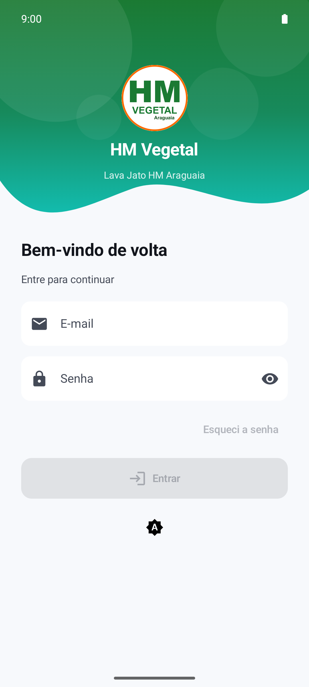
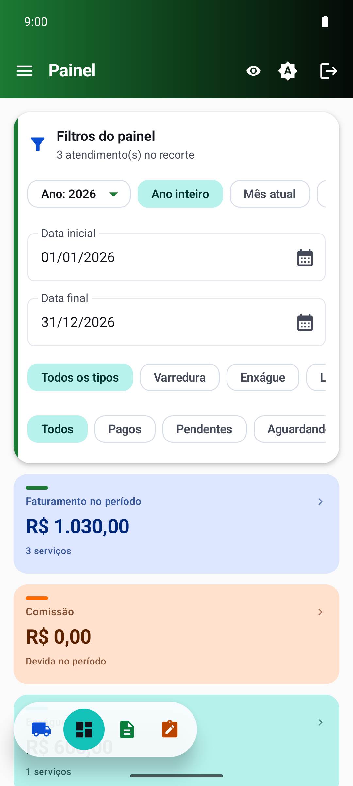

# HM Vegetal Lavador

Segundo cliente da plataforma que criei para o [Stop Trucks](https://github.com/fariascelso/stop-trucks-higienizador): um higienizador de caminhões do mesmo ramo, em Alto Araguaia (MT).

> O código-fonte é privado porque contém dados reais do cliente. Este repositório apresenta o projeto.

## O que foi feito
- Adaptei o sistema do Stop Trucks para o novo cliente: marca própria, projeto Firebase próprio e versão web no ar.
- Regras de negócio do cliente, como a comissão por colaborador.
- Mostra que a base em Kotlin Multiplatform foi pensada para ser reaproveitada entre empresas do mesmo segmento.

## Stack
Kotlin Multiplatform · Compose Multiplatform · Firebase · IA com especificação (SDD e PRD)

## Telas (Android, dados de demonstração)

 

---
**English:** Second customer of my truck-cleaning management platform: same Kotlin Multiplatform codebase, rebranded with its own Firebase project and client-specific rules (per-employee commission).
